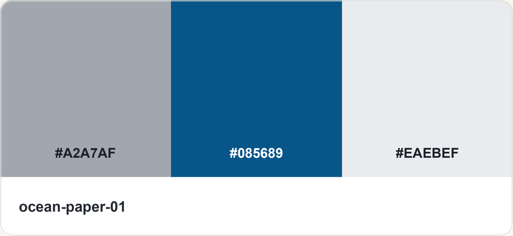
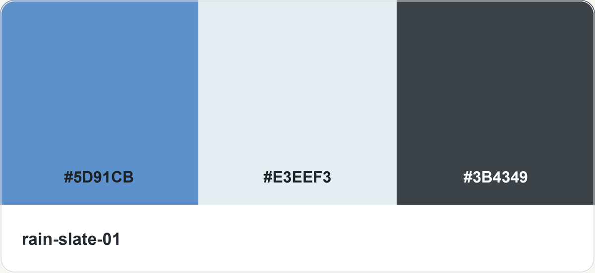
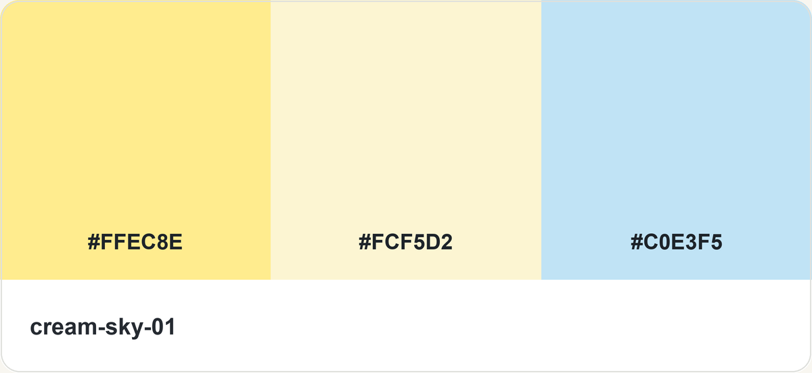

# Mood Palette

[简体中文](README.zh-CN.md) · [Browse all palette images](preview.html)

A palette skill for choosing colors in everyday language and applying them to image generation or UI design. Includes **100 three-color records, 12 themes, and 100 clean three-column palette cards rendered from HEX values**. Recommendations show the stored pictures directly, without generating replacement search charts.

## Choose a language

Both versions are complete, including instructions, references, theme names, CLI messages, tests, and image assets. They share IDs, HEX values, search behavior, and image files.

| Version | Skill directory |
|---|---|
| English | [skills/en/mood-palette](skills/en/mood-palette/SKILL.md) |
| 简体中文 | [skills/zh-CN/mood-palette](skills/zh-CN/mood-palette/SKILL.md) |

Install **one** version: copy its entire `mood-palette` directory into your Codex skills directory, normally `~/.codex/skills/`. Both use `$mood-palette`; installing both creates a duplicate name. Python 3.8+ is needed for lookup, search, and contrast helpers; they use only the standard library. Image generation uses an image tool already available in the host, such as imagegen.

## Use it

```text
$mood-palette Recommend five blue-themed palettes for me to choose from.
$mood-palette Show me light, muted pink palettes.
Choose option 3 and generate a landscape ceramic still-life illustration with it.
$mood-palette Recolor my current page with moss-tea-05, preserving layout and interactions.
```

Browsing returns stored clean palette cards with brief descriptions. A later selection reuses the exact ID previously shown. Actual illustrations, posters, and UI mockups are generated only when requested. Values-only requests return copyable HEX. See [full English examples](skills/en/mood-palette/references/usage.md).

### Example: blue-themed choices

These cards are rendered only from catalog HEX values and directly reused:

| 1 · Blue-gray, deep blue, light gray | 2 · Blue, icy white, slate | 3 · Light blue, lilac, blue | 4 · Ink, blue, warm red | 5 · Soft yellow, cream, light blue |
|---|---|---|---|---|
|  |  |  |  |  |

## Verify

From either installed skill directory:

```bash
python3 scripts/palette.py --self-test
python3 scripts/test_search.py
python3 scripts/palette.py --search blue --limit 5
```

Search returns structured JSON, including `image` paths relative to the skill directory. The agent resolves and displays the files. The CLI does not generate new pictures. IDs, source HEX, and image mapping remain stable between languages.

## Accuracy and public package

99 records contain approximate image samples; one uses transcribed HEX labels. All 100 images are independently rendered three-column cards at 1200×552, using the stored HEX values only. Theme names are newly assigned organizational labels; this does not assert original authorship of the reference color arrangements. UI-derived colors must be identified and measured for contrast. See [accuracy notes](skills/en/mood-palette/references/accuracy.md).

This release includes clean HEX-rendered palette cards and necessary skill files only. Reference images and their crops, account details, source links, local absolute paths, personal agent instructions, captured prompts, conversations, credentials, and work logs are excluded. `agents/openai.yaml` contains only generic display metadata. Documentation contains generic usage examples, not conversation exports. PNG assets contain no embedded metadata.

Publish only this release directory, rather than its parent working folder. Reference images and reference-image history are excluded.
