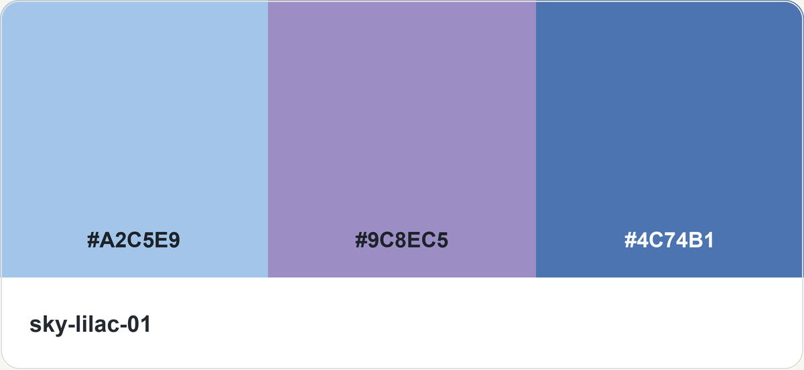
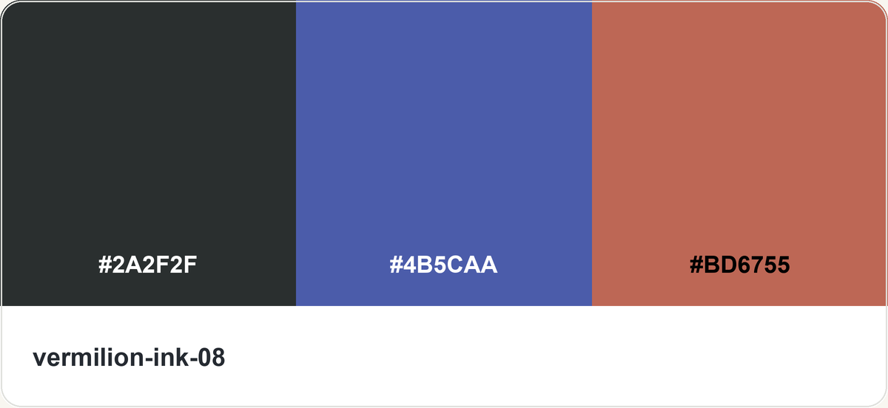

# Mood Palette

[English](README.md) · [浏览全部配色图片](preview.html)

用“蓝色、粉红色、明亮、低饱和”等日常语言选择配色，并用于生图或 UI。包含 **12 个主题、100 组三色记录与 100 张三栏纯色色卡**。检索后直接展示库内已有图片，不重新画检索图。

## 中英文版本

两版都包含完整说明、参考文档、主题名、脚本提示、测试与配色图片；编号、HEX、检索逻辑和图片一致。

| 版本 | Skill 目录 |
|---|---|
| English | [skills/en/mood-palette](skills/en/mood-palette/SKILL.md) |
| 简体中文 | [skills/zh-CN/mood-palette](skills/zh-CN/mood-palette/SKILL.md) |

**任选一版安装**：将对应的整个 `mood-palette` 目录复制到 Codex 的 skills 目录，通常为 `~/.codex/skills/`。两版都用 `$mood-palette`，不要同时安装造成重名。检索、查编号和测对比度需要 Python 3.8+，仅使用标准库；实际生图使用宿主已有的 imagegen 等工具。

## 直接这样用

```text
$mood-palette 推荐 5 组以蓝色为主的配色，给我看配色图，供我选择。
$mood-palette 给我看看浅一点、低饱和的粉红色配色。
选第 3 组，用它生成一张横版陶器静物插画。
$mood-palette 用 moss-tea-05 给当前页面改色，保留布局和交互。
```

默认推荐 5 组，每组直接展示对应的原有配色图片，附简短描述；名称、编号和 HEX 是补充。用户选定后沿用上一轮实际编号；要求插画、海报或 UI 示意图时才生图。只要色值时返回可复制文字。更多场景见 [中文调用示例](skills/zh-CN/mood-palette/references/usage.md)。

### 蓝色主题的展示示例

下列图片仅由库内 HEX 绘制，直接复用：

| 1 · 蓝灰、深蓝、浅灰 | 2 · 蓝、冰白、青灰 | 3 · 浅蓝、淡紫、蓝 | 4 · 墨黑、蓝、暖红 | 5 · 浅黄、奶油白、浅蓝 |
|---|---|---|---|---|
|  |  |  |  |  |

## 验证

在任一版本包含 `SKILL.md` 的目录运行：

```bash
python3 scripts/palette.py --self-test
python3 scripts/test_search.py
python3 scripts/palette.py --search blue --limit 5
```

脚本返回结构化 JSON，包含相对 Skill 目录的 `image` 路径，由调用方解析并展示对应图片。脚本不生成新图片。两版的编号、原始三色和图片映射一致。

## 准确性与发布范围

99 组为图像采样近似值，1 组为可辨认 HEX 转录。100 张图片均由 HEX 独立绘制为 1200×552 的三栏纯色色卡。主题名是重新整理的检索标签，不代表参考色组为原创。UI 补色需标注应用派生并测对比度，详见 [准确性说明](skills/zh-CN/mood-palette/references/accuracy.md)。

本发布目录只包含由 HEX 绘制的纯色色卡与必需文件；不包含任何参考原图或裁片、来源链接、账号资料、本机绝对路径、个人代理指令、历史提示词、对话、凭据和工作日志。`agents/openai.yaml` 仅含通用展示信息；文档中保留的是通用调用例句，不是历史对话导出。PNG 已清除嵌入元数据。

发布时只上传本目录，不要上传上层工作目录。本包不包含参考图片或其历史版本。
